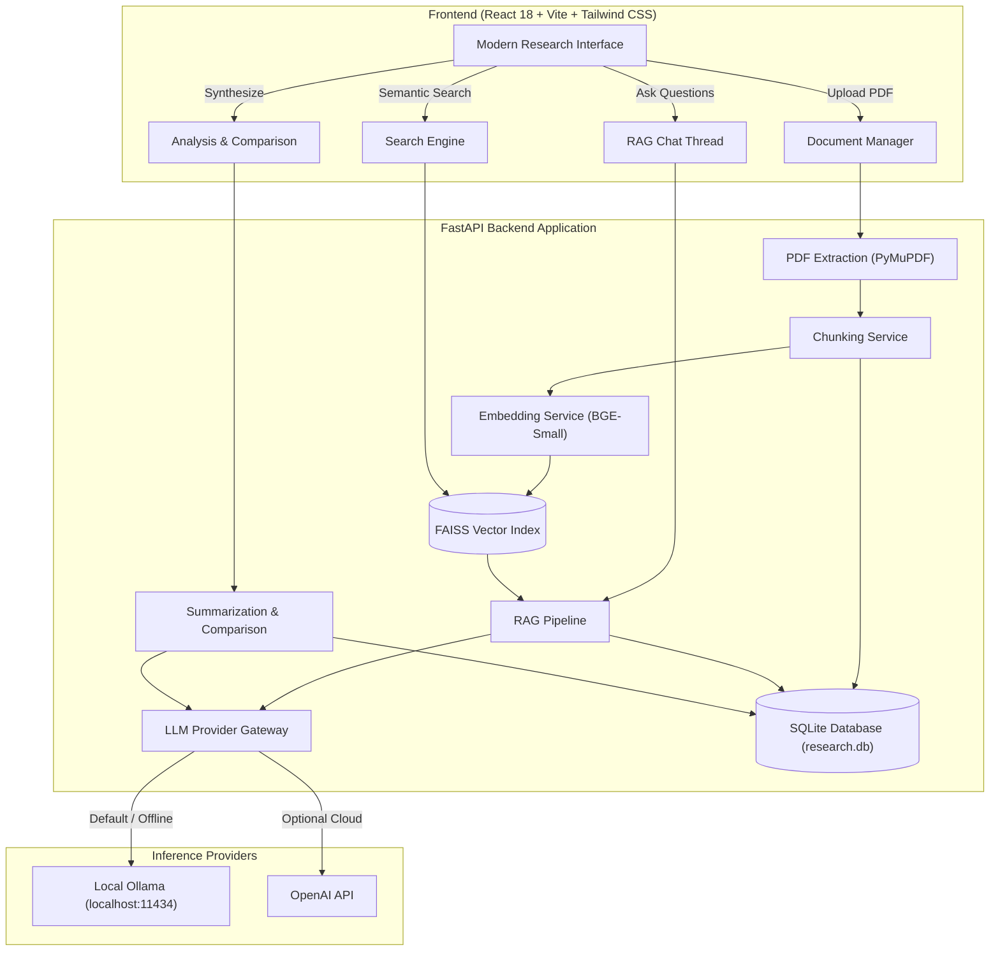

<div align="center">

# 📄🤖 AI Research Paper Assistant

**An open-source, local-first personal AI assistant engineered for researchers, engineers, and students to read, query, synthesize, and compare academic papers with grounded page-level citations.**

<br />

[](LICENSE)
[](https://python.org)
[](https://fastapi.tiangolo.com)
[](https://reactjs.org)
[](https://vitejs.dev)
[](https://tailwindcss.com)
[](https://github.com/facebookresearch/faiss)
[](https://ollama.com)

<br />

<!-- Buy Me A Coffee / Book Button -->
<a href="https://www.buymeacoffee.com/JinggXD" target="_blank">
  
</a>

<br /><br />

[Key Features](#-key-features) •
[Architecture](#-system-architecture) •
[Quickstart](#-quickstart-guide) •
[Tech Stack](#-tech-stack) •
[Project Structure](#-project-structure) •
[API Documentation](#-api-endpoints) •
[Contributing](#-contributing) •
[License](#-license)

</div>

---

## 🌟 Key Features

- 🔒 **Local-First & 100% Privacy-Preserving**: Your research PDFs, extracted text chunks, embeddings, and chat histories stay on your local disk. No papers are transmitted to remote cloud APIs unless you explicitly configure OpenAI.
- 📑 **Robust Academic PDF Processing**:
  - High-fidelity page-by-page text extraction with PyMuPDF.
  - Automatic de-hyphenation, Unicode normalization, and layout header heuristics.
  - Automatic title, author, year, and abstract detection.
  - Built-in SHA-256 duplicate detection and scanned-PDF OCR warning flags.
- 🔍 **Dense Semantic Vector Retrieval**:
  - Sentence Transformers (`BAAI/bge-small-en-v1.5`) mapped to a persistent FAISS CPU vector index.
  - Query across your entire multi-paper library or filter dynamically to a specific document.
- 🎯 **Hallucination-Resistant Grounded RAG**:
  - Answers are strictly constructed from retrieved paper excerpts.
  - Verifiable inline citations (`[Source N, Page X]`) mapping directly to real pages in the source document.
  - Explicit warning when papers lack sufficient context to answer a question.
- 💬 **Multi-Turn Research Chat**:
  - Library-wide or paper-scoped persistent conversation sessions.
  - Context-aware dialogue memory with full citation tracing stored in SQLite.
- 📊 **Single-Paper Structured Summaries**:
  - Deep academic breakdown covering: Problem Statement, Core Contributions, Methodology, Model Architectures, Datasets, Key Results, Limitations, and Future Work.
  - Permanent SQLite summary caching with instant loads and on-demand force-refresh.
- ⚖️ **Multi-Paper Comparative Analysis**:
  - Side-by-side comparison matrix for 2 to 10 papers across research methodology, architectures, benchmarks, performance, and synthesizes cross-paper research gaps.
  - Persistent comparison history with markdown and JSON export.
- 🔌 **Dual LLM Provider Support**:
  - **Ollama**: Zero-cost, 100% offline inference (e.g., `llama3.2:latest`, `mistral`, `qwen2.5`).
  - **OpenAI**: Cloud inference with user-provided API keys (`gpt-4o-mini`, `gpt-4o`).
  - Dynamic runtime switching without restarting backend services.

---

## 🏗️ System Architecture



---

## 🚀 Quickstart Guide

### Prerequisites
- **Python**: 3.11, 3.12, or 3.13
- **Node.js**: v18.0+ or v20.0+ (with `npm`)
- **Git**
- *(Recommended)* **Ollama**: Download from [ollama.com](https://ollama.com) and pull a model:
  ```bash
  ollama run llama3.2:latest
  ```

---

### 1. Clone the Repository

```bash
git clone https://github.com/your-username/ai-research-assistant.git
cd ai-research-assistant
```

---

### 2. Start the Backend (FastAPI)

#### Windows (PowerShell):
```powershell
cd backend
python -m venv .venv
.\.venv\Scripts\Activate.ps1
pip install -r requirements.txt
Copy-Item .env.example .env
uvicorn app.main:app --reload --host 127.0.0.1 --port 8000
```

#### macOS / Linux:
```bash
cd backend
python3 -m venv .venv
source .venv/bin/activate
pip install -r requirements.txt
cp .env.example .env
uvicorn app.main:app --reload --host 127.0.0.1 --port 8000
```

- API Base URL: `http://127.0.0.1:8000`
- Interactive OpenAPI Docs: `http://127.0.0.1:8000/docs`

---

### 3. Start the Frontend (React + Vite)

Open a new terminal window:

```bash
cd ai-research-assistant/frontend
npm install
cp .env.example .env
npm run dev
```

Open your browser at **`http://localhost:5173`**.

---

## 💻 Tech Stack

| Domain | Technology | Description |
| :--- | :--- | :--- |
| **Backend Framework** | FastAPI (Python 3.11+) | Async high-performance REST API |
| **Database** | SQLite + SQLAlchemy 2.0 | Persistent relational storage for documents, chunks, chats, and summaries |
| **PDF Extraction** | PyMuPDF (fitz) | Fast page-by-page text extraction with layout heuristics |
| **Embeddings** | Sentence Transformers | Local `BAAI/bge-small-en-v1.5` dense text embeddings (384d) |
| **Vector Index** | FAISS CPU | Dense similarity search with cosine normalization |
| **LLM Inference** | Ollama & OpenAI | Offline local models (Llama 3.2) or cloud API fallback |
| **Frontend Framework**| React 18 | Component-driven SPA architecture |
| **Build Tool** | Vite 6 | Lightning-fast HMR and optimized production bundling |
| **Styling** | Tailwind CSS 3.4 | Custom editorial design system with light/dark themes |
| **Icons & UI** | Lucide React | Clean, modern iconography |
| **Markdown** | React Markdown + remark-gfm | Academic paper formatted output rendering |

---

## 📁 Project Structure

```text
ai-research-assistant/
├── .github/
│   ├── workflows/
│   │   └── ci.yml               # GitHub Actions CI workflow (lint & test)
│   ├── ISSUE_TEMPLATE/
│   │   ├── bug_report.md        # Bug report template
│   │   └── feature_request.md   # Feature request template
│   ├── pull_request_template.md # PR submission template
│   └── FUNDING.yml              # Sponsor & Buy Me a Coffee config
├── backend/
│   ├── app/
│   │   ├── core/                # Configuration, database, and logging
│   │   ├── models/              # SQLAlchemy ORM models (documents, chats, summaries)
│   │   ├── routers/             # FastAPI API endpoints
│   │   ├── schemas/             # Pydantic validation models
│   │   ├── services/            # PDF parsing, RAG, embeddings, vector store, LLM
│   │   └── main.py              # Application factory & lifespan
│   ├── storage/                 # Local document storage, vectors & SQLite DB
│   ├── tests/                   # Automated pytest suite
│   ├── .env.example             # Backend environment template
│   ├── pyproject.toml           # Python package metadata
│   ├── requirements.txt         # Production dependencies
│   └── README.md                # Backend technical guide
├── frontend/
│   ├── src/
│   │   ├── api/                 # Axios HTTP client endpoints
│   │   ├── components/          # Reusable UI widgets, modals, layout
│   │   ├── context/             # Theme, backend health, and toast state
│   │   ├── pages/               # Dashboard, Library, Chat, Analysis, Comparison, Settings
│   │   ├── App.jsx              # Routing & root layout
│   │   ├── index.css            # Custom CSS & Tailwind styles
│   │   └── main.jsx             # Entry point
│   ├── public/                  # Static assets
│   ├── .env.example             # Frontend environment template
│   ├── package.json             # NPM dependencies & build scripts
│   ├── tailwind.config.js       # Design system colors & spacing
│   ├── vite.config.js           # Vite bundle configuration
│   └── README.md                # Frontend documentation
├── .gitignore                   # Multi-language root ignore rules
├── CONTRIBUTING.md              # Contributor onboarding & code standards
├── LICENSE                      # MIT Open Source License
└── README.md                    # Root project documentation
```

---

## 🔌 API Endpoints

| Method | Endpoint | Description |
| :--- | :--- | :--- |
| `GET` | `/` | API status and metadata |
| `GET` | `/health` | Live database, storage, and provider health |
| `POST` | `/documents/upload` | Upload & extract PDF, generate embeddings & index chunks |
| `GET` | `/documents` | List uploaded papers with search and sorting |
| `GET` | `/documents/{id}` | Paper metadata, page text, and chunks |
| `DELETE`| `/documents/{id}` | Delete paper, extracted data, vectors, and cached summaries |
| `POST` | `/search/` | Semantic dense vector retrieval across papers |
| `POST` | `/search/rebuild` | Full rebuild and re-synchronization of FAISS index |
| `POST` | `/chat/conversations` | Create library-wide or paper-scoped chat thread |
| `POST` | `/chat/conversations/{id}/messages` | Grounded RAG query with page citations |
| `GET` | `/papers/{id}/summary` | Retrieve cached academic summary |
| `POST` | `/papers/{id}/summary` | Generate or refresh structured single-paper summary |
| `POST` | `/papers/compare` | Multi-paper comparison matrix across 2-10 papers |
| `GET` | `/settings` | Retrieve active LLM provider and retrieval settings |
| `PATCH`| `/settings` | Update runtime provider (Ollama / OpenAI) and parameters |

Explore interactive documentation live at `http://127.0.0.1:8000/docs`.

---

## ☕ Support & Sponsorship

If you find **AI Research Paper Assistant** useful for your research, studies, or projects, please consider supporting the ongoing development:

<div align="center">
  <br />
  <a href="https://www.buymeacoffee.com/JinggXD" target="_blank">
    
  </a>
  <br />
  <p>Every book helps support deeper exploration and open-source tooling for the research community!</p>
</div>

---

## 🤝 Contributing

Contributions are warmly welcomed! Please read our [Contributing Guide](CONTRIBUTING.md) to get started with local development, code standards, and PR workflows.

---

## 📄 License

This project is open-source and released under the [MIT License](LICENSE).
