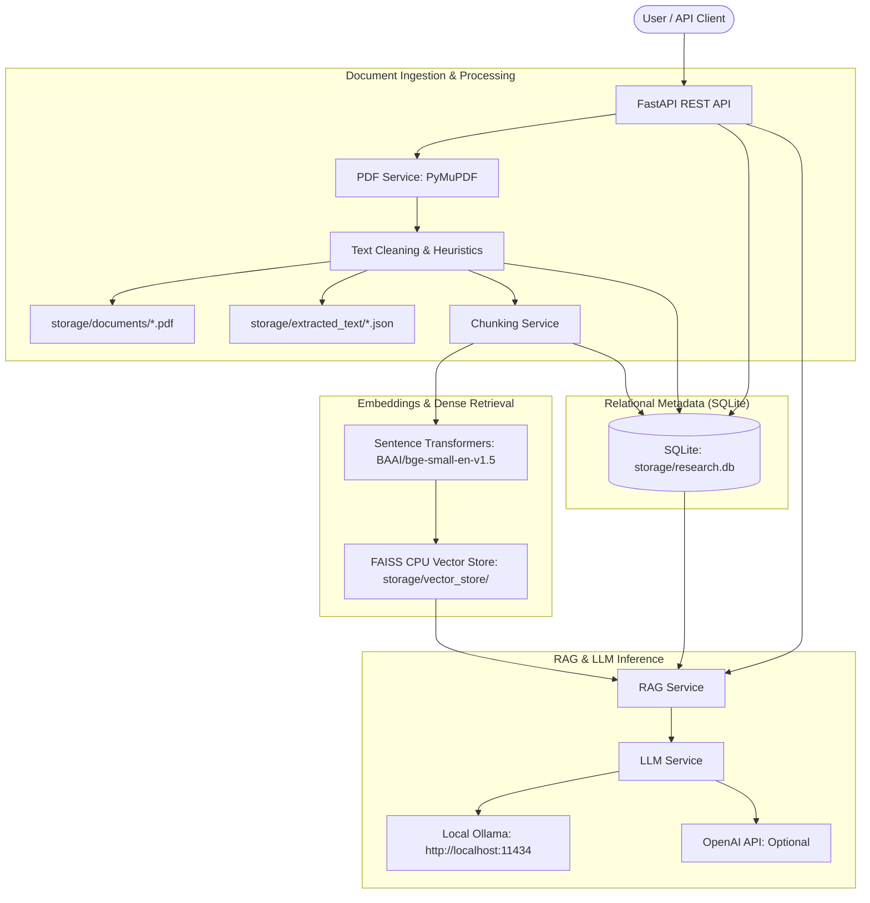

# AI Research Paper Assistant 📄🤖

An open-source, **local-first**, privacy-conscious personal AI assistant built for researchers, students, and engineers. Upload academic papers in PDF format, explore them using dense semantic search, ask grounded research questions with verifiable page-level citations, generate structured summaries, and run multi-paper comparative analyses.

---

## 🌟 Key Features

- **Local-First & Privacy-Focused**: Your research library, embeddings, extracted texts, and SQLite metadata stay on your local disk. No documents are uploaded to third parties without your explicit opt-in.
- **Robust PDF Processing**:
  - Page-by-page text extraction with Unicode normalization and hyphenation healing via PyMuPDF.
  - SHA-256 duplicate detection.
  - Automatic layout heuristics for titles, authors, publication years, and abstracts.
  - Automatic detection of scanned documents requiring OCR (`ocr_needed`).
- **Semantic Vector Search**:
  - Dense similarity search powered by FAISS CPU and Sentence Transformers (`BAAI/bge-small-en-v1.5`).
  - Search across your entire research library or isolate queries to specific papers.
  - Automatic vector store synchronization on document upload, deletion, and reprocessing.
- **Hallucination-Resistant RAG**:
  - Grounded answers constructed exclusively from retrieved paper passages.
  - Verifiable source citations with page numbers and section headers (`[Source N, Page X]`).
  - Explicit notification whenever papers lack sufficient evidence to answer.
- **Interactive Multi-Turn Conversations**:
  - Chat with your entire research library or start focused conversations scoped to a specific paper.
  - Context-window memory retaining conversation continuity.
  - Permanent persistence of source citations per assistant response in SQLite.
- **Academic Research Tools**:
  - **Single-Paper Summarization**: Extracts problem statements, research contributions, methodology, model architectures, datasets, results, limitations, and future work.
  - **Multi-Paper Comparison**: Compares 2 to 10 papers across methodology, architectures, benchmarks, performance, and synthesizes cross-paper research gaps.
- **Flexible LLM Provider Layer**:
  - **Ollama**: Zero-cost, 100% offline local inference (e.g., Llama 3.2, Mistral, Qwen).
  - **OpenAI API**: Cloud inference with user-provided API keys (e.g., GPT-4o-mini).
  - Dynamic runtime switching without restarting or changing code.
  - Sensitive API key masking across all endpoints and logs.

---

## 🏗️ Architecture



---

## 📋 System Requirements

- **Python**: 3.11, 3.12, or 3.13
- **Operating System**: Windows 10/11, macOS 12+, or modern Linux (Ubuntu 22.04+)
- **Memory**: Minimum 4 GB RAM (8 GB+ recommended for local embedding inference)
- **Disk Space**: ~2 GB for Python dependencies and local embedding models

---

## 🚀 Installation & Setup

### 1. Clone the Repository
```bash
git clone https://github.com/Kabirofficial/AI-Research-Paper-Assistant.git
cd AI-Research-Paper-Assistant/backend
```

### 2. Set Up Virtual Environment

#### On Windows (PowerShell):
```powershell
python -m venv .venv
.\.venv\Scripts\Activate.ps1
```

#### On Linux / macOS:
```bash
python3 -m venv .venv
source .venv/bin/activate
```

### 3. Install Dependencies
```bash
pip install -r requirements.txt
```

### 4. Configure Environment
Copy the example environment configuration:
```bash
cp .env.example .env
```
*(On Windows PowerShell, use `Copy-Item .env.example .env`)*

---

## 🤖 LLM Provider Configuration

### Option A: Local Inference with Ollama (Recommended / 100% Offline)
1. Download and install Ollama from [ollama.com](https://ollama.com).
2. Start the Ollama service and pull your preferred model:
   ```bash
   ollama pull llama3.2:latest
   ```
3. Set your `.env` configuration:
   ```env
   LLM_PROVIDER="ollama"
   OLLAMA_BASE_URL="http://localhost:11434"
   OLLAMA_MODEL="llama3.2:latest"
   ```

### Option B: Cloud Inference with OpenAI
1. Obtain an API key from [platform.openai.com](https://platform.openai.com).
2. Set your `.env` configuration:
   ```env
   LLM_PROVIDER="openai"
   OPENAI_API_KEY="sk-your-openai-api-key"
   OPENAI_MODEL="gpt-4o-mini"
   ```

*(You can also switch providers at any time via the `PUT /settings/` endpoint or Swagger UI without editing `.env` or restarting).*

---

## 🏃 Running the Application

Start the local server:
```bash
uvicorn app.main:app --reload --host 127.0.0.1 --port 8000
```

Once running:
- **Interactive Swagger Documentation**: [http://127.0.0.1:8000/docs](http://127.0.0.1:8000/docs)
- **Interactive ReDoc**: [http://127.0.0.1:8000/redoc](http://127.0.0.1:8000/redoc)
- **Health Check**: [http://127.0.0.1:8000/health](http://127.0.0.1:8000/health)

---

## 📡 REST API Reference

### Health & General
| Method | Endpoint | Description |
| :--- | :--- | :--- |
| `GET` | `/` | API name, version, and status |
| `GET` | `/health` | Health diagnostics (database, storage, provider status) |

### Document Management
| Method | Endpoint | Description |
| :--- | :--- | :--- |
| `POST` | `/documents/upload` | Upload and process a PDF (extracts text, chunks, and metadata) |
| `GET` | `/documents/` | List all uploaded papers with pagination |
| `GET` | `/documents/{id}` | Get metadata and status for a specific paper |
| `GET` | `/documents/{id}/text` | Retrieve extracted page-by-page text and full text |
| `GET` | `/documents/{id}/chunks` | Inspect semantic chunk breakdown for a document |
| `GET` | `/documents/{id}/download` | Download original uploaded PDF |
| `DELETE` | `/documents/{id}` | Delete paper, database records, and stored files |
| `POST` | `/documents/{id}/reprocess` | Re-extract metadata and re-index PDF |

### Semantic Search
| Method | Endpoint | Description |
| :--- | :--- | :--- |
| `POST` | `/search/` | Semantic dense vector search across library or specific papers |
| `GET` | `/search/status` | FAISS index health, dimension, and vector counts |
| `POST` | `/search/rebuild` | Re-embed all chunks and rebuild FAISS index from SQLite |

### Chat & Conversations
| Method | Endpoint | Description |
| :--- | :--- | :--- |
| `POST` | `/chat/conversations` | Create conversation (optionally scoped to a `document_id`) |
| `GET` | `/chat/conversations` | List conversations with message counts |
| `GET` | `/chat/conversations/{id}` | Retrieve conversation history with all messages and citations |
| `POST` | `/chat/conversations/{id}/messages` | Post user question and receive grounded answer with source citations |
| `DELETE` | `/chat/conversations/{id}` | Delete conversation and message history |

### Academic Research Tools & Analysis
| Method | Endpoint | Description |
| :--- | :--- | :--- |
| `GET` | `/papers/{id}/summary` | Retrieve previously generated and cached academic summary |
| `POST` | `/papers/{id}/summary` | Generate academic summary with optional `force_refresh` caching |
| `POST` | `/papers/compare` | Compare 2 to 10 papers across technical dimensions and persist result |
| `GET` | `/papers/comparisons` | List all saved multi-paper comparative analyses with pagination |
| `GET` | `/papers/comparisons/{id}` | Retrieve a specific saved comparative analysis |
| `DELETE` | `/papers/comparisons/{id}` | Delete a saved comparative analysis |

### Settings & Configuration
| Method | Endpoint | Description |
| :--- | :--- | :--- |
| `GET` | `/settings/` | View current settings (sensitive API keys are masked) |
| `PUT` | `/settings/` | Update settings at runtime (switch providers, models, chunk sizes) |
| `GET` | `/settings/providers` | Check live connectivity and model lists for Ollama and OpenAI |
| `POST` | `/settings/test-connection` | Diagnose connection and measure latency to a provider |

---

## ⚙️ Configuration Reference

All settings can be configured via environment variables or a local `.env` file:

| Variable | Default | Description |
| :--- | :--- | :--- |
| `PROJECT_NAME` | `AI Research Paper Assistant` | Application display name |
| `ENVIRONMENT` | `development` | Deployment environment |
| `DEBUG` | `True` | Enable debug mode and verbose logging |
| `HOST` | `127.0.0.1` | Server host binding |
| `PORT` | `8000` | Server port binding |
| `DATABASE_URL` | `sqlite:///./storage/research.db` | SQLAlchemy SQLite connection string |
| `STORAGE_DIR` | `./storage` | Directory for PDFs, extracted text, and FAISS indices |
| `MAX_UPLOAD_SIZE_MB` | `50` | Maximum allowed PDF file upload size |
| `CHUNK_SIZE` | `800` | Target chunk size in tokens (~3200 characters) |
| `CHUNK_OVERLAP` | `120` | Chunk overlap in tokens (~480 characters) |
| `EMBEDDING_MODEL` | `BAAI/bge-small-en-v1.5` | Sentence Transformers embedding model |
| `TOP_K_RETRIEVAL` | `5` | Default number of relevant chunks retrieved for RAG |
| `LLM_PROVIDER` | `ollama` | Active LLM provider (`ollama` or `openai`) |
| `OLLAMA_BASE_URL` | `http://localhost:11434` | URL of the local Ollama instance |
| `OLLAMA_MODEL` | `llama3.2:latest` | Active Ollama model name |
| `OPENAI_API_KEY` | `""` | User's personal OpenAI API key (optional) |
| `OPENAI_MODEL` | `gpt-4o-mini` | Active OpenAI model name |

---

## 🧪 Running Automated Tests

The repository includes a comprehensive automated test suite with temporary SQLite databases and storage isolation.

Run all tests:
```bash
pytest -v
```

All 56 tests run completely offline and finish in a few seconds:
```text
============================= test session starts =============================
tests/test_chat.py (4 tests) ........................ PASSED
tests/test_chunking.py (4 tests) .................... PASSED
tests/test_documents.py (9 tests) ................... PASSED
tests/test_embeddings.py (4 tests) .................. PASSED
tests/test_health.py (2 tests) ...................... PASSED
tests/test_llm.py (6 tests) ......................... PASSED
tests/test_papers.py (4 tests) ...................... PASSED
tests/test_rag.py (4 tests) ......................... PASSED
tests/test_reliability.py (7 tests) ................. PASSED
tests/test_search.py (6 tests) ...................... PASSED
tests/test_settings.py (4 tests) .................... PASSED
============================= 54 passed in 6.22s ==============================
```

---

## 🔒 Security & Privacy Guarantees

1. **Single-User Architecture**: No authentication or multi-tenant sharing. Designed for private local use.
2. **Zero External Document Leakage**: Documents, text files, and vector embeddings are stored strictly on your local disk under `./storage`.
3. **No Unsolicited API Calls**: If you use Ollama, 100% of text and embeddings remain offline. No data is ever sent to OpenAI unless you explicitly configure an OpenAI API key and set `LLM_PROVIDER="openai"`.
4. **Credential Masking**: API keys are masked (`sk-...1234`) across GET endpoints and internal application logs.
5. **Path Traversal Protection**: Uploaded files receive internal UUID filenames to eliminate path traversal vulnerabilities.

---

## ⚠️ Known Limitations

- **Scanned PDFs**: Scanned PDFs without a digital text layer are automatically detected and marked as `ocr_needed`. To process scanned files, OCR preprocessing (e.g. Tesseract) can be applied.
- **Complex Mathematical Tables**: PyMuPDF extracts plain text characters accurately, but deeply nested multi-column tables or complex LaTeX matrices are flattened into linear text representations.

---

## ☕ Support

If you find this backend service helpful, consider supporting future development:

<a href="https://www.buymeacoffee.com/JinggXD"></a>

---

## 📄 License

This project is licensed under the [MIT License](LICENSE).

